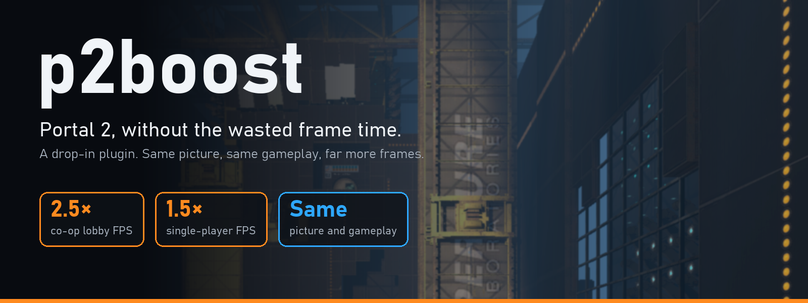
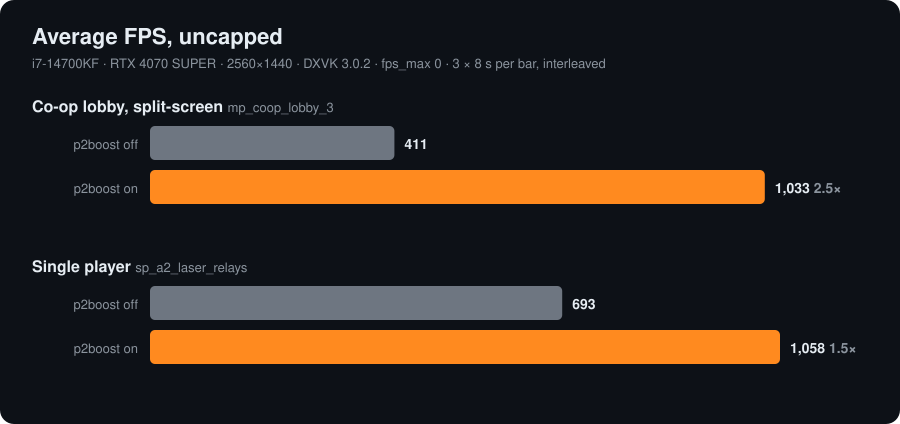
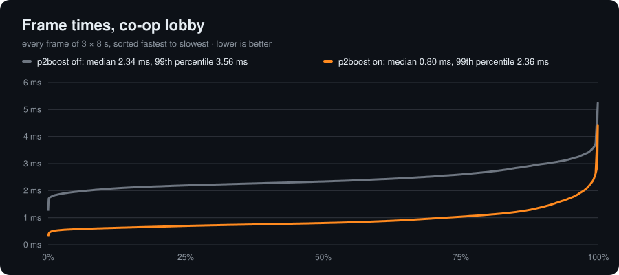
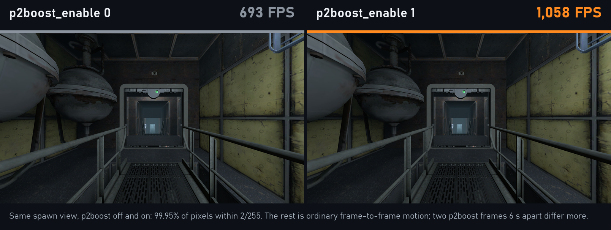
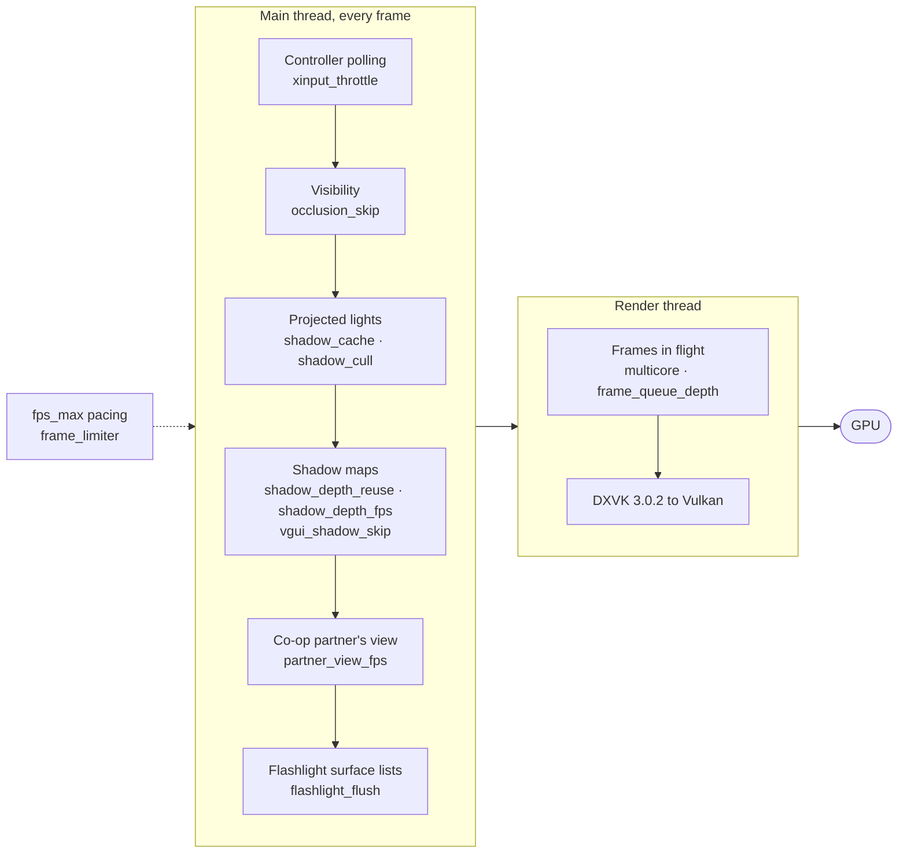

<p align="center">
  
</p>

<p align="center">
  <a href="https://github.com/aIIison/p2boost/actions/workflows/build-release.yml"></a>
  
  
  
</p>

<p align="center">
  <b>A drop-in performance plugin for Portal 2 on Windows.</b><br>
  It removes work the game wastes every frame: same picture, same input, same gameplay, far more frames.
</p>

<p align="center">
  <a href="#install">Install</a> ·
  <a href="#what-it-fixes">What it fixes</a> ·
  <a href="#commands">Commands</a> ·
  <a href="docs/technical.md">How it works</a>
</p>

> [!WARNING]
> **p2boost is not currently approved for Portal 2 speedrun submissions.**
> The moderator agreement is that it remains disallowed until it has been
> fully verified. Do not record a run with p2boost loaded if you may want to
> submit it: a run recorded before a future approval stays ineligible even
> after the plugin is approved, and unloading the plugin later does not change
> that.

## Showcase

Portal 2 is held back by one CPU core, not by your graphics card. p2boost
targets exactly that work: duplicated shadow rendering, engine bookkeeping
that grows with old history instead of the current scene, controller polling
when no controller is plugged in, an occlusion pass that can never cull
anything on official maps, a render thread that stalls the game whenever one
frame runs long, and the slow 2020-era DXVK the game ships with.

<p align="center">
  
</p>

Every frame gets cheaper, not just the average: in the co-op lobby the median
frame drops from 2.34 ms to 0.80 ms, and the slowest 1% from 3.56 ms to
2.36 ms.

<p align="center">
  
</p>

The picture does not change. `p2boost_enable 0` and `1` at the same spawn:

<p align="center">
  
</p>

Measured with `scripts\bench.ps1` on an i7-14700KF and RTX 4070 SUPER at
2560×1440, uncapped, both variants in alternating rounds of the same session.
Your gain depends on your CPU and the scene; CPU-heavy scenes such as the co-op
lobby gain the most. The release also replaces the game's DXVK with DXVK 3.0.2,
which on this machine is another 2.2× in the lobby on its own (482 → 1,070 FPS
with every fix on). A Ryzen 7 7800X3D with an RTX 5090 measured it slower, so
that part depends on your hardware; see
[benchmarks/plus-automated.md](benchmarks/plus-automated.md).

### Where the time goes

Each fix removes one specific cost from a frame:



## Requirements

- Portal 2 on Steam for Windows, build `23973718` (the current Steam build).
  Portal Stories: Mel is also supported.
- The Vulkan renderer: add `-vulkan` to the game's launch options.

## Install

1. Download `p2boost-nightly-win32.zip` from the latest release.
2. Extract it into your `Portal 2` game folder. `p2boost.dll` goes next to
   `portal2.exe`, and `bin\dxvk_d3d9.dll` goes into `bin\`. The zip already
   has this layout.
3. In Steam, open Portal 2 → Properties → Launch Options and add `-vulkan`.
4. Add `plugin_load p2boost` to `portal2\cfg\autoexec.cfg` (create the file
   if it does not exist; for Portal Stories: Mel use
   `portal_stories\cfg\autoexec.cfg`).
5. Start the game, open the console, and run `p2boost_status`. It should say
   `supported build` and `fixes enabled`.

> [!NOTE]
> **NVIDIA users:** on first start p2boost may show a one-time message and
> close the game. It has set the driver option that prevents a black screen
> after alt-tabbing out of the Vulkan renderer. Start the game again; this
> happens only once. If Windows asks for permission, that is p2boost writing
> that one driver setting for `portal2.exe`.

**Uninstall:** remove the `plugin_load p2boost` line from your autoexec and
delete `p2boost.dll`. To put back Valve's original DXVK, delete
`bin\dxvk_d3d9.dll` and verify the game files in Steam (or run
`scripts\restore-dxvk.ps1`).

## What it fixes

Every performance fix is on by default. `p2boost_enable 0` switches all of
them off at once so you can compare against stock Portal 2, and
`p2boost_enable 1` turns them back on. Each fix can also be changed on its own
with `p2boost_fix <name> <value>`; `p2boost_fix` alone lists them with their
current values.

**Shadows**

| Fix | Default | What it does |
|---|:---:|---|
| `shadow_cache` | 1 | Skips rebuilding projected-light data that has not changed. |
| `shadow_cull` | 1 | Skips shadow maps for lights whose volume cannot touch your view. Set it to 0 if a shadow seen only through a portal ever disappears. |
| `shadow_depth_reuse` | 1 | In split-screen, the second player reuses shadow maps the first view already rendered this frame, unless a player is standing in that light. |
| `shadow_depth_fps` | 120 | Keeps shadow maps across frames and refreshes each at most this many times per second (0 = every frame). A light that moves re-renders at once; a moving object's shadow can lag by up to 1/N s. |
| `vgui_shadow_skip` | 1 | Stops in-world wall screens from being redrawn into every light's shadow map. |
| `flashlight_flush` | 1 | Clears the engine's per-light surface lists in proportion to what was used, not to their all-time size. |

**Co-op and split-screen**

| Fix | Default | What it does |
|---|:---:|---|
| `partner_view_fps` | 120 | Renders your co-op partner's view at most this many times per second and redraws the last picture in between (0 = every frame): the `+remote_view` picture, or in local split-screen the half of the player you are not controlling (`in_forceuser`). The view you control always renders every frame. Works with `mat_viewportscale`. |
| `vgui_screen_fps` | 0 | Opt-in: repaints in-world screens (lobby score boards, chamber signs) at most this many times per second and draws the last picture from a cached texture in between (0 = off). Opaque screens look the same; glowing or translucent screen art (the lobby boards' player figures) composites against the wall differently, which is why it is off by default. Try 60 for about +7%. |

**Engine overhead and threading**

| Fix | Default | What it does |
|---|:---:|---|
| `xinput_throttle` | 1 | Checks empty controller slots once per second instead of every frame. A newly plugged controller is detected within a second. |
| `occlusion_skip` | 1 | Skips an occlusion pass that cannot hide anything on maps without occluders (all official maps). |
| `multicore` | 1 | Keeps Portal 2's multicore rendering (`mat_queue_mode 2`) on, even when the video options or a mod's map script turn it off. |
| `frame_queue_depth` | 2 | Lets the render thread run up to two frames behind the game instead of one (`mat_queue_mode 2` only), so a frame whose rendering takes longer than the next game frame no longer stalls it. Adds up to one frame of display latency; 1 = the engine's behaviour. |
| `frame_limiter` | 1 | Makes `fps_max` deliver the frame rate you set instead of about 2% less. |

Per-fix contributions, measured on a second machine (Ryzen 7 7800X3D,
RTX 5090), are in [benchmarks/plus-automated.md](benchmarks/plus-automated.md).

## Commands

| Command | What it does |
|---|---|
| `p2boost_status` | Build support, renderer, DXVK version, and every fix with its counters. |
| `p2boost_enable 0\|1` | Global switch for all fixes. |
| `p2boost_fix [name] [value]` | Lists the fixes, or shows or sets one. `p2boost_fix shadow_depth_fps` also lists the lights whose shadow maps are cached. |
| `p2boost_overlay 0\|1\|2` | Frame-time overlay: off, full profiler, or large FPS counter (turns red during hitches). |
| `p2boost_trace 0\|1` | Records frame times; `p2boost_trace 0` writes them to `p2boost_metrics.csv` in the game folder. |
| `p2boost_update [force]` | Downloads and verifies the latest release in the background; it loads on the next start. |
| `p2boost_flat_textures 0\|1` | Optional visual mode (off by default): solid-color surfaces, with transparency and the UI kept intact. |
| `r_intensity <0.0..2.0>` | Overall brightness multiplier (1.0 = unchanged). |

p2boost also makes `mat_monitorgamma` and `mat_viewportscale` work under
Vulkan, as they do under DirectX.

<details>
<summary><b>Troubleshooting</b></summary>

- **`p2boost_status` says unsupported:** your game or one of its files does
  not match the supported Steam build. Verify the game files in Steam. A
  failed check never installs anything.
- **Black screen after alt-tab (NVIDIA):** start the game once more after
  p2boost's one-time message, so the driver profile takes effect.
- **Antivirus flags `dxvk_d3d9.dll`:** some antivirus products flag 32-bit
  DXVK builds. The included file is the official DXVK 3.0.2 release; its
  SHA-256 must be
  `44a2e749694128710cce3a545c954bd9d986dd6a8ea61bb08d931c2ef0190488`, which
  `p2boost_status` also prints.
- **SAR:** works with p2boost in either load order.

</details>

<details>
<summary><b>Building from source</b></summary>

Requires Visual Studio 2019 or newer, CMake 3.24 or newer, and the Windows
SDK (for its x86 `fxc.exe` shader compiler).

```powershell
.\scripts\build.ps1
.\scripts\install.ps1 -GameRoot 'D:\SteamLibrary\steamapps\common\Portal 2'
.\scripts\uninstall.ps1 -GameRoot 'D:\SteamLibrary\steamapps\common\Portal 2'
```

`install.ps1` copies the DLL next to `portal2.exe` and adds the
`plugin_load p2boost` line to your autoexec.

To measure changes yourself, `scripts\bench.ps1` launches the game, loads the
co-op lobby, and compares variants in alternating rounds with confidence
intervals:

```powershell
.\scripts\bench.ps1 -Variant 'stock=p2boost_enable 0','p2boost=p2boost_enable 1'
```

</details>

## How it works

[docs/technical.md](docs/technical.md) explains every change: the problem, how
it was found, what is patched, why the picture stays the same, and the
measurements. [research/](research/README.md) holds the profiling and
reverse-engineering tools and the archived investigation log.
